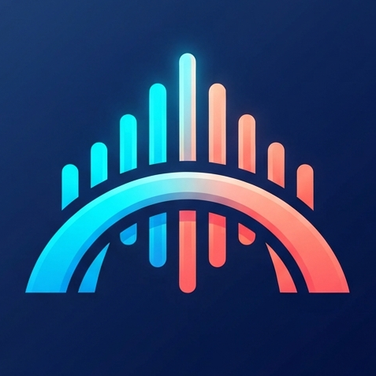

<div align="center">
  
  <h1>EchoBridge</h1>
  <p><strong>100% Offline Neural Voice-to-Voice Translator for Android</strong></p>

  <p>
    <a href="https://github.com/franciscogimenez365-ai/EchoBridge/releases/latest">
      
    </a>
    <a href="#license">
      
    </a>
  </p>

  <p>
    <a href="https://ko-fi.com/fenork" target="_blank">
      
    </a>
    <a href="https://cafecito.app/fenork" target="_blank">
      
    </a>
  </p>
</div>


---
## Changelog

### v1.0.1
* Kept screen awake during initial model downloads (`wakelock_plus`) to prevent OS network suspension.
* Moved `.tar.bz2` model extraction to a background `Isolate` to eliminate UI freezes (ANR) on mid-range devices.

## About EchoBridge

**EchoBridge** is an open-source, privacy-first mobile application designed to translate spoken conversations between **Spanish and English** in real time **without an internet connection**.

Unlike traditional translators that stream your voice to cloud servers, EchoBridge runs lightweight neural networks directly on your device's hardware:

1. **Speech-to-Text (STT):** Powered locally by **Whisper Base (quantized INT8)** via `sherpa-onnx`.
2. **Neural Machine Translation (NMT):** Powered locally by **MarianMT (`opus-mt-es-en` / `opus-mt-en-es`)** running on **ONNX Runtime**.
3. **Text-to-Speech (TTS):** Synthesized natively using Android's offline TTS engine.

> **Note:** On first launch, the app downloads the required local AI models (~210 MB total) directly from Hugging Face and GitHub Releases. Once downloaded, EchoBridge works completely offline (even in Airplane Mode).

---

## Architecture

* **Frontend:** Flutter (Dart) — Conversation UI, audio permission management, and streaming model downloader with resume support.
* **Native Audio & AI Engine:** Android (Kotlin + JNI/C++) — Low-latency 16kHz PCM audio capture via `AudioRecord`, local inference via `sherpa-onnx` and `onnxruntime-android`.

---

## Building from Source

1. Clone this repository:
   ```bash
   git clone https://github.com/franciscogimenez365-ai/EchoBridge
   cd echo_bridge
   ```
2. Install Flutter dependencies:
   ```bash
   flutter pub get
   ```
3. Run on an Android device (API 24+):
   ```bash
   flutter run
   ```

---

## Credits & Third-Party Licenses

EchoBridge is built on top of incredible open-source projects and openly licensed AI models:

* **[sherpa-onnx](https://github.com/k2-fsa/sherpa-onnx)** by k2-fsa — Licensed under **Apache License 2.0**.
* **[Whisper](https://github.com/openai/whisper)** by OpenAI (ONNX weights converted by `csukuangfj`) — Licensed under **MIT License**.
* **[OPUS-MT / MarianMT](https://huggingface.co/Helsinki-NLP)** by Helsinki-NLP (ONNX quantized weights by `Xenova`) — Licensed under **CC-BY-4.0**.
* **[ONNX Runtime](https://github.com/microsoft/onnxruntime)** by Microsoft — Licensed under **MIT License**.

---

## License

This project is licensed under the **MIT License** — see the [LICENSE](LICENSE) file for details.
---

## ☕ Support the Project

**EchoBridge** is 100% free, open-source, and runs completely offline without subscriptions or data tracking. I build these tools out of pure passion, and every contribution directly buys me more time to optimize local neural models, add new languages, and keep the project actively maintained.

If EchoBridge was useful to you, consider supporting its development:

<p>
    <a href="https://ko-fi.com/fenork" target="_blank">
      
    </a>
    <a href="https://cafecito.app/fenork" target="_blank">
      
</p>

